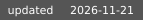
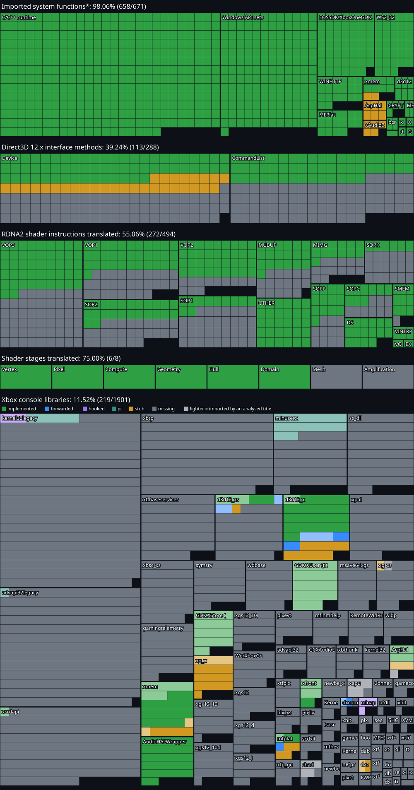

# xbox-pc-port

Running Xbox Series X|S builds on PC via [drycheetah84/TomBox](https://github.com/drycheetah84/TomBox).

Uses legally obtained, already-decrypted dumps. The runtime does no key extraction or package decryption.

## Status

[](docs/img/progress.svg)
[](#milestones)
[](#tested-titles)
[](docs/DEVELOPMENT_LOG.md)

[](docs/img/progress.svg)

<sub>One square per item: green = done, amber = partial, grey = not done. Sections: toolchain, dump pipeline, boot sequence, features, and a mirror of upstream TomBox's reported progress. Regenerate with `py tools/progress/gen.py` after editing `tools/progress/data.json`.</sub>

### Milestones

| # | Milestone | State |
|---|---|---|
| 1 | TomBox toolchain built | done |
| 2 | Fortnite dump extracted | pending download |
| 3 | First boot under `mdbg` | not started |
| 4 | Reaches lobby | upstream reports yes, not reproduced locally |
| 5 | Keyboard input | not started |
| 6 | Controller input | not started |
| 7 | 3D scene correct | not started |
| 8 | Audio | not started |
| 9 | Playable gameplay | not started |

### Tested titles

| Title | Build | Result |
|---|---|---|
| Fortnite XSX | 2.0.1461.7919 | runtime staged, awaiting decrypted dump |

## Documents

- [STATUS.md](STATUS.md) — current snapshot
- [docs/DEVELOPMENT_LOG.md](docs/DEVELOPMENT_LOG.md) — chronological log
- [docs/BLOCKERS.md](docs/BLOCKERS.md) — standing walls

## Updating progress

Edit `tools/progress/data.json`, then:

```
py tools/progress/gen.py
```

That regenerates `docs/img/progress.svg` and all four badge SVGs. Commit and push.
